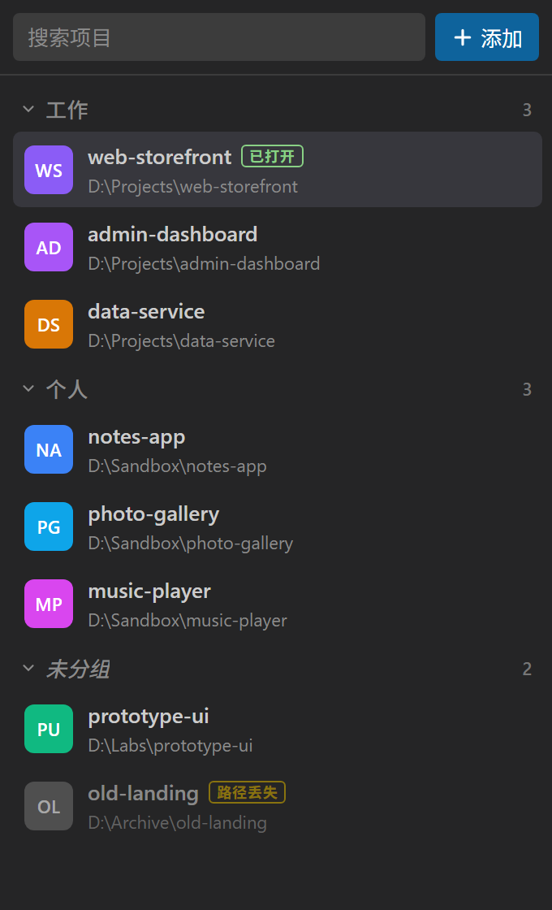

# Project Rail

**VS Code 项目管理器。** 所有项目集中一处，分组归类，一键切换。

仓库与问题反馈：[github.com/OneFanki/project-rail](https://github.com/OneFanki/project-rail)



## 解决什么问题

VS Code 自带文件树、最近打开列表、命令面板——但它们都不认识「项目」这个概念。你一周要
在七八个仓库之间来回切，每次都要走「文件 → 打开文件夹 → 翻目录」或者在一个越滚越长的
最近列表里找。

Project Rail 补上这一层：一份**你自己维护的项目清单**，不是被动记录你打开过什么。

## 特性

- **集中管理** —— 所有项目一个列表，而不是散落在最近打开记录里
- **分组归类** —— 工作、个人分开；折叠收纳，拖拽调整
- **一键切换** —— 点卡片替换当前窗口，或右键在新窗口打开，每次都由你决定
- **卡片而非列表** —— 每个项目有从路径生成的配色徽章，四个名字相近的仓库也能一眼分清
- **搜索过滤** —— 按名称或路径实时筛选
- **路径丢失提示** —— 文件夹被移走或删除时标记出来，可直接移出清单

> 一个项目就是一个文件夹。这只是实现方式，真正的功能是让项目有条理、随手可达。

## 使用

点击活动栏的 Project Rail 图标打开侧边栏。

### 添加项目

| 方式                       | 入口                                 |
| -------------------------- | ------------------------------------ |
| 添加一个或多个文件夹       | **添加** → _添加已有文件夹..._       |
| 把当前打开的文件夹存为项目 | **添加** → _将当前文件夹保存为项目_  |
| 选一个文件夹并在这里打开   | **添加** → _打开文件夹作为项目..._   |
| 选一个文件夹并在新窗口打开 | **添加** → _在新建窗口打开文件夹..._ |
| 新建分组                   | **添加** → _新建分组..._             |

### 操作项目

| 操作                   | 方法                                         |
| ---------------------- | -------------------------------------------- |
| 在当前窗口打开         | 单击卡片，或右键 → _在当前窗口打开_          |
| 在新窗口打开           | 右键 → _在新窗口打开_，或中键单击            |
| 移动到分组             | 右键 → _移动到分组..._，或直接拖到分组标题上 |
| 在文件资源管理器中显示 | 右键 → _在文件资源管理器中显示_              |
| 从清单移除             | 右键 → _从列表移除_（文件夹本身不会删除）    |
| 折叠分组               | 单击分组标题                                 |
| 重命名 / 删除分组      | 右键分组标题                                 |

单击卡片会替换当前窗口的工作区。如果希望单击总是开新窗口，把
`projectRail.openInNewWindow` 设为 `true`。无论怎么设置，右键菜单始终提供两种方式。

项目名固定取文件夹自身的名字，所以不会和磁盘上的实际情况脱节。

## 设置

| 设置项                        | 默认值  | 说明                       |
| ----------------------------- | ------- | -------------------------- |
| `projectRail.openInNewWindow` | `false` | 单击卡片时在新窗口打开项目 |

## 界面语言

界面跟随 VS Code 的显示语言。内置简体中文与英文，其他语言回退到英文。

## 环境要求

VS Code 1.90 或更新版本。无运行时依赖、无遥测、不联网。项目清单保存在 VS Code 的全局
状态里，所有窗口共享。

## 开发

```bash
npm install
npm run watch        # 改动时自动打包
npm run typecheck
npm test
npm run icon         # 从 media/icon.svg 重新生成 media/icon.png
npm run preview      # 把侧边栏 UI 各状态渲染成 PNG
npm run screenshots  # 重新生成商店页截图
```

按 `F5` 启动扩展开发宿主。

`npm run preview` 用无头 Chromium 加载 webview 标记并注入假数据，把各状态渲染成 `.p-*.png`，
改布局时不必手点 VS Code。

## 许可证

MIT

## 链接

- 仓库：[github.com/OneFanki/project-rail](https://github.com/OneFanki/project-rail)
- 问题反馈：[github.com/OneFanki/project-rail/issues](https://github.com/OneFanki/project-rail/issues)
- 更新日志：[CHANGELOG.md](https://github.com/OneFanki/project-rail/blob/main/CHANGELOG.md)
